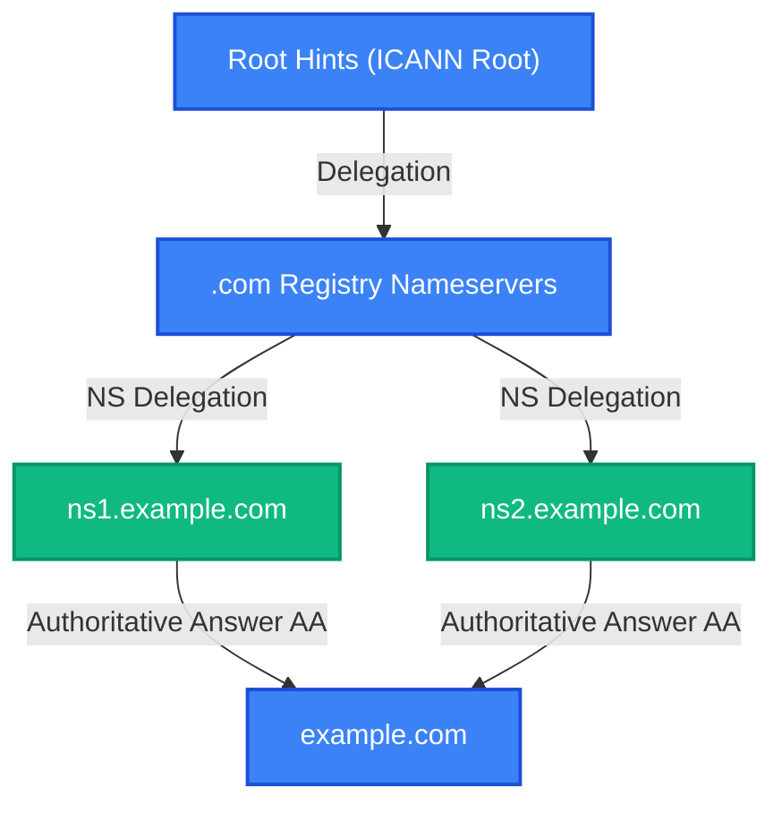

# domain-doctor

[](https://github.com/smford/domain-doctor/actions/workflows/ci.yml)
[](https://github.com/smford/domain-doctor/releases)
[](https://scorecard.dev/viewer/?uri=github.com/smford/domain-doctor)
[](http://stephenford.org/domain-doctor/)
[](LICENSE)

**A production-grade, authoritative-first domain health inspection, DNS diagnostic analysis, and TLS autopsy CLI & TUI utility.**

`domain-doctor` evaluates internet domain reliability, security, and infrastructure resilience. By directly querying authoritative nameservers over raw UDP/TCP and cross-referencing public Anycast recursive resolvers worldwide, it uncovers delegation errors, mail deliverability misconfigurations, transport security vulnerabilities, RFC 2308 negative cache staleness, BGP routing single points of failure, and infrastructure-as-code drift.

---

## 💡 What Problems Does `domain-doctor` Solve?

- **RFC 2308 Negative Caching Inconsistencies**: When you update or create a DNS record, public Anycast resolvers (1.1.1.1, 8.8.8.8, 9.9.9.9) may continue serving cached `NXDOMAIN` or `NODATA` answers according to the SOA Minimum TTL. `domain-doctor` queries authoritative nameservers for ground truth, probes public resolvers in parallel, calculates exact remaining eviction seconds ($\min(\text{SOA.TTL}, \text{SOA.MINIMUM})$), and pinpoints where cache staleness is preventing traffic flow.
- **Silent Email Deliverability Failures (SPF PermError & DMARC)**: Exceeding 10 DNS lookups in SPF records triggers an immediate RFC 7208 `PermError`, causing legitimate emails to be marked as spam or silently dropped. `domain-doctor` recursively traverses all `include`, `a`, `mx`, and `redirect` mechanisms, counts lookups, validates DMARC policies (`p=reject`), and probes common DKIM selectors.
- **Dangling CNAMEs & Subdomain Takeovers**: Orphaned CNAME records pointing to decommissioned AWS S3 buckets, CloudFront distributions, GitHub Pages, or Heroku apps expose your domain to complete subdomain takeover. `domain-doctor` verifies CNAME targets against cloud signature matrices and alerts on unclaimed resources.
- **DNSSEC Chain of Trust Breaks**: A mismatched DS record at the registrar or an expired RRSIG signature causes validating resolvers to return `SERVFAIL` to users. `domain-doctor` validates parent DS digests, child DNSKEYs, and RRSIG validity dates.
- **BGP Autonomous System (ASN) Single Points of Failure**: Many organizations delegate DNS to multiple nameservers that all reside within the same BGP Autonomous System or IPv4 /24 subnet. `domain-doctor` maps nameserver IPs to origin ASNs via Team Cymru DNS queries without third-party REST APIs, warning when a single upstream routing incident could disable the entire domain.
- **Out-of-Band Terraform State Drift**: When DNS changes are made manually in cloud consoles rather than through Infrastructure as Code, your `terraform.tfstate` becomes out of sync. `domain-doctor audit-drift` reads your state file and flags all out-of-band drifts.

---

## 📦 Installation

### Homebrew (macOS & Linux)

```bash
brew tap smford/tap
brew install domain-doctor
```

### Docker Container

```bash
docker pull ghcr.io/smford/domain-doctor:latest
docker run --rm ghcr.io/smford/domain-doctor:latest scan example.com
```

### Go Install

```bash
go install github.com/smford/domain-doctor/cmd/domain-doctor@latest
```

### Pre-Compiled Binaries

Download pre-compiled hermetic static binaries (`CGO_ENABLED=0`) for macOS and Linux from the [GitHub Releases](https://github.com/smford/domain-doctor/releases) page.

---

## 🚀 Quick Start & Worked Examples

### 1. Full Spectrum Domain Scan

Execute the complete diagnostic matrix on any domain:

```bash
domain-doctor scan github.com
```

**Realistic Terminal Output:**

```text
╔════════════════════════════════════════════════════════════════════╗
║                    DOMAIN DOCTOR AUDIT REPORT                      ║
╚════════════════════════════════════════════════════════════════════╝
Target Domain   : github.com
Overall Health  : 95/100 (Grade: A+)
Scan Duration   : 1.42s
Nameservers     : dns1.p08.nsone.net, dns2.p08.nsone.net, ns-1283.awsdns-32.org, ns-1707.awsdns-21.co.uk
Findings Summary: 14 PASS | 2 INFO | 0 WARN | 0 CRIT

── DNS Checks ────────────────────────────────────────────────────────
  [PASS] DNS-NS-COUNT: 4 authoritative nameservers discovered
    Nameservers: dns1.p08.nsone.net, dns2.p08.nsone.net, ns-1283.awsdns-32.org, ns-1707.awsdns-21.co.uk
  [PASS] DNS-SOA-SYNC: All authoritative nameservers synchronized on SOA serial 2026102501
  [PASS] DNS-TCP-OK: TCP fallback functional on port 53 (RTT: 28ms)
  [PASS] DNS-AXFR-SECURE: Zone transfer (AXFR) properly refused on all authoritative nameservers
  [PASS] DNS-RECURSION-CLOSED: Open recursion disabled across authoritative nameservers

── NEGATIVECACHE Checks ──────────────────────────────────────────────
  [PASS] NEGCACHE-CLEAN: No stale RFC 2308 negative caching observed across public resolvers
    All tested Anycast resolvers (1.1.1.1, 8.8.8.8, 9.9.9.9, OpenDNS) return synchronized answers.

── MAIL Checks ───────────────────────────────────────────────────────
  [PASS] SPF-LOOKUP-COUNT-HEALTHY: SPF record lookup count healthy (3 / 10 allowed)
  [PASS] DMARC-POLICY-REJECT: Strong DMARC policy configured (p=reject)
  [PASS] DKIM-SELECTORS-DISCOVERED: Active DKIM public keys discovered for selector(s): [s1, s2]

── RESILIENCE Checks ─────────────────────────────────────────────────
  [PASS] BGP-ASN-DIVERSE: Resilient BGP routing diversity: Authoritative fleet spans 2 ASNs (AS16509, AS19994)
    Nameservers are distributed across distinct autonomous systems (Amazon Route53 & NS1).
```

---

### 2. Live Cutover Watch Mode

When performing a DNS migration, nameserver transfer, or record cutover, launch continuous watch mode:

```bash
domain-doctor watch example.com --interval 3s
```

Tracks authoritative SOA serial changes, record transitions, and negative cache evictions in a real-time Bubble Tea TUI dashboard.

---

### 3. Generate Mermaid Architecture Diagrams

Generate production-ready Mermaid `.mmd` diagrams directly to stdout:

```bash
# Delegation chain diagram
domain-doctor diagram example.com --type=delegation

# SPF include tree with lookup counts
domain-doctor diagram example.com --type=spf

# Mail flow and DMARC alignment gate
domain-doctor diagram example.com --type=mail
```



---

### 4. Zone Snapshot & Migration Diffing

Save a topology snapshot before making DNS changes, then verify live propagation afterward:

```bash
# 1. Snapshot prior state
domain-doctor snapshot mydomain.com -o pre-migration.json

# 2. Diff live DNS against pre-migration baseline
domain-doctor diff pre-migration.json mydomain.com
```

```text
=== Zone Topology Diff: mydomain.com ===

[MODIFIED] A Records:
  - Snapshot: 198.51.100.10
  + Live:     203.0.113.25

[ADDED] TXT Records:
  + Live:     v=spf1 include:_spf.google.com ~all
```

---

### 5. Headless CI/CD Policy Linting

Integrate into GitHub Actions, GitLab CI, or deployment gates to block breaking DNS changes:

```bash
# Exit code 1 on critical findings; exit code 2 on warnings (strict mode)
domain-doctor lint mydomain.com --policy=strict --format=sarif > results.sarif
```

---

### 6. Audit Terraform State Drift

Detect out-of-band record alterations by comparing your `terraform.tfstate` directly against live DNS:

```bash
domain-doctor audit-drift mydomain.com --tf-state=terraform.tfstate
```

---

### 7. Export to BIND Zone or Terraform HCL

Reverse-engineer active DNS records into reusable infrastructure code:

```bash
# Export standard RFC 1035 BIND zone file
domain-doctor export mydomain.com --format=bind

# Export Terraform Route53 HCL resources
domain-doctor export mydomain.com --format=hcl
```

---

## 🛠 Command Reference

| Subcommand | Description |
| :--- | :--- |
| `scan <domain>` | Run full diagnostic suite with terminal table output (`--json`, `--tui`, `--mermaid`) |
| `watch <domain>` | Continuous polling TUI dashboard for tracking live DNS cutovers (`--interval=3s`) |
| `snapshot <domain>` | Export current zone records and diagnostic findings to structured JSON |
| `diff <file.json> <domain>` | Compare a previously captured JSON snapshot against live DNS |
| `lint <domain>` | CI/CD policy audit with exit codes and SARIF / Markdown output (`--policy=strict`) |
| `diagram <domain>` | Generate Mermaid diagrams (`--type=delegation|spf|mail`) |
| `export <domain>` | Export discovered records as standard RFC 1035 BIND or Terraform Route53 HCL |
| `audit-drift <domain>` | Compare declared Route53/Cloudflare resources in `terraform.tfstate` against live DNS |
| `serve` | Run HTTP `/healthz` daemon on port 8080 |
| `completion <shell>` | Generate shell autocompletions (`bash`, `zsh`, `fish`, `powershell`) |

---

## 📄 License

Licensed under the [MIT License](LICENSE).
Copyright (c) 2026 Simon Ford.
