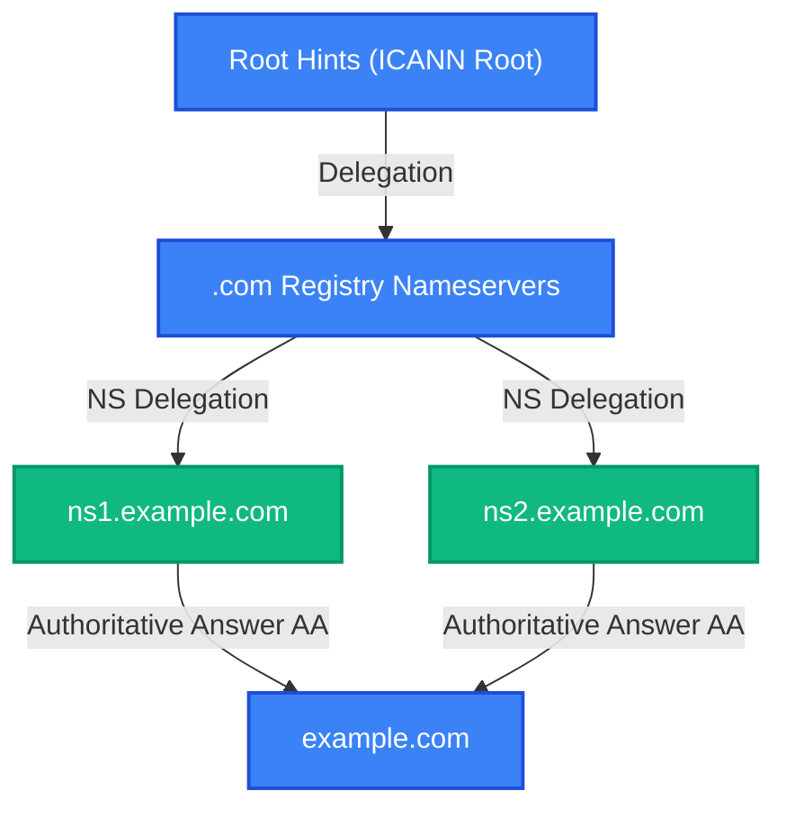

# domain-doctor

[](https://github.com/smford/domain-doctor/actions/workflows/ci.yml)
[](https://github.com/smford/domain-doctor/releases)
[](https://scorecard.dev/viewer/?uri=github.com/smford/domain-doctor)
[](http://stephenford.org/domain-doctor/)
[](LICENSE)

**A production-grade, authoritative-first domain health inspection, DNS diagnostic analysis, and TLS autopsy CLI & TUI utility.**

<p align="center">
  
</p>

`domain-doctor` evaluates internet domain reliability, security, and infrastructure resilience. By directly querying authoritative nameservers over raw UDP/TCP and cross-referencing public Anycast recursive resolvers worldwide, it uncovers delegation errors, mail deliverability misconfigurations, transport security vulnerabilities, RFC 2308 negative cache staleness, BGP routing single points of failure, and infrastructure-as-code drift.

---

## 💡 What Problems Does `domain-doctor` Solve?

- **RFC 2308 Negative Caching Inconsistencies**: When you update or create a DNS record, public Anycast resolvers (1.1.1.1, 8.8.8.8, 9.9.9.9) may continue serving cached `NXDOMAIN` or `NODATA` answers according to the SOA Minimum TTL. `domain-doctor` queries authoritative nameservers for ground truth, probes public resolvers in parallel, calculates exact remaining eviction seconds ($\min(\text{SOA.TTL}, \text{SOA.MINIMUM})$), and pinpoints where cache staleness is preventing traffic flow.
- **Silent Email Deliverability Failures (SPF PermError & DMARC)**: Exceeding 10 DNS lookups in SPF records triggers an immediate RFC 7208 `PermError`, causing legitimate emails to be marked as spam or silently dropped. `domain-doctor` recursively traverses all `include`, `a`, `mx`, and `redirect` mechanisms, counts lookups, validates DMARC policies (`p=reject`), and probes common DKIM selectors.
- **Dangling CNAMEs & Subdomain Takeovers**: Orphaned CNAME records pointing to decommissioned AWS S3 buckets, CloudFront distributions, GitHub Pages, or Heroku apps expose your domain to complete subdomain takeover. `domain-doctor` verifies CNAME targets against cloud signature matrices and alerts on unclaimed resources.
- **DNSSEC Chain of Trust Breaks**: A mismatched DS record at the registrar or an expired RRSIG signature causes validating resolvers to return `SERVFAIL` to users. `domain-doctor` validates parent DS digests, child DNSKEYs, and RRSIG validity dates.
- **BGP Autonomous System (ASN) Single Points of Failure**: Many organizations delegate DNS to multiple nameservers that all reside within the same BGP Autonomous System or IPv4 /24 subnet. `domain-doctor` maps nameserver IPs to origin ASNs via Team Cymru DNS queries without third-party REST APIs, warning when a single upstream routing incident could disable the entire domain.
- **Out-of-Band Terraform State Drift**: When DNS changes are made manually in cloud consoles rather than through Infrastructure as Code, your `terraform.tfstate` becomes out of sync. `domain-doctor audit-drift` reads your state file and flags all out-of-band drifts.

---

## 📦 Installation

### Homebrew (macOS & Linux)

```bash
brew tap smford/tap
brew install domain-doctor
```

### Docker Container

```bash
docker pull ghcr.io/smford/domain-doctor:latest
docker run --rm ghcr.io/smford/domain-doctor:latest scan example.com
```

### Go Install

```bash
go install github.com/smford/domain-doctor/cmd/domain-doctor@latest
```

### Pre-Compiled Binaries

Download pre-compiled hermetic static binaries (`CGO_ENABLED=0`) for macOS and Linux from the [GitHub Releases](https://github.com/smford/domain-doctor/releases) page.

---

## 🚀 Quick Start & Worked Examples

### 1. Full Spectrum Domain Scan

Execute the complete diagnostic matrix on any domain:

```bash
domain-doctor scan example.com
```

**Realistic Terminal Output:**

```text
╔════════════════════════════════════════════════════════════════════╗
║                    DOMAIN DOCTOR AUDIT REPORT                      ║
╚════════════════════════════════════════════════════════════════════╝
Target Domain   : example.com
Overall Health  : 95/100 (Grade: A+)
Scan Duration   : 1.24s
Nameservers     : ns1.example.com, ns2.example.com
Findings Summary: 21 PASS | 5 INFO | 1 WARN | 0 CRIT

── DNS Checks ────────────────────────────────────────────────────────
  [PASS] DNS-NS-COUNT (DD-DNS-001): 2 authoritative nameservers discovered
    Nameservers: ns1.example.com, ns2.example.com
  [PASS] DNS-SOA-SYNC (DD-DNS-001): All authoritative nameservers synchronized on SOA serial 2026102501
  [PASS] DNS-TCP-OK (DD-DNS-001): TCP fallback functional on port 53 (RTT: 24ms)
  [PASS] DNS-AXFR-SECURE (DD-DNS-002): Zone transfer (AXFR) properly refused on all authoritative nameservers
  [PASS] DNS-RECURSION-CLOSED (DD-DNS-003): Open recursion disabled across authoritative nameservers

── NEGATIVECACHE Checks ──────────────────────────────────────────────
  [PASS] NEGCACHE-CLEAN (DD-NC-001): No stale RFC 2308 negative caching observed across public resolvers
    All tested Anycast resolvers (1.1.1.1, 8.8.8.8, 9.9.9.9) return synchronized answers.

── MAIL Checks ───────────────────────────────────────────────────────
  [PASS] SPF-LOOKUP-COUNT-HEALTHY (DD-MAIL-001): SPF record lookup count healthy (3 / 10 allowed)
  [PASS] DMARC-POLICY-REJECT (DD-MAIL-002): Strong DMARC policy configured (p=reject)
  [PASS] DKIM-SELECTORS-DISCOVERED (DD-MAIL-003): Active DKIM public keys discovered for selector(s): [s1, s2]
  [PASS] MTA-STS-ENFORCED (DD-MAIL-005): Valid MTA-STS policy discovered in mode 'enforce' (id: 20261025)

── SECURITY Checks ───────────────────────────────────────────────────
  [PASS] DNSSEC-CHAIN-VALID (DD-SEC-001): DNSSEC chain-of-trust validated (DS -> DNSKEY -> RRSIG)
  [PASS] CAA-POLICY-DEFINED (DD-SEC-004): Valid CAA record configured restricting authorized issuers
  [PASS] TLS-HEALTHY (DD-SEC-005): Certificate valid (runway: 74 days, TLS 1.3, strong cipher suites)
  [INFO] PSL-COOKIE-BOUNDARY (DD-SEC-009): Domain operates at organizational boundary (eTLD+1) under .com

── RESILIENCE Checks ─────────────────────────────────────────────────
  [PASS] BGP-ASN-DIVERSE (DD-RES-001): Resilient BGP routing diversity: Authoritative fleet spans 2 ASNs (AS13335, AS15169)
  [PASS] EDNS-BUFFER-COMPLIANT (DD-RES-003): Nameservers adhere to DNS Flag Day 2020 buffer standards (1232 bytes)
```

---

### 2. Live Cutover Watch Mode

When performing a DNS migration, nameserver transfer, or record cutover, launch continuous watch mode:

```bash
domain-doctor watch example.com --interval 3s
```

Tracks authoritative SOA serial changes, record transitions, and negative cache evictions in a real-time Bubble Tea TUI dashboard:

<p align="center">
  
</p>

---

### 3. Generate Mermaid Architecture Diagrams

Generate production-ready Mermaid `.mmd` diagrams directly to stdout:

```bash
# Delegation chain diagram
domain-doctor diagram example.com --type=delegation

# SPF include tree with lookup counts
domain-doctor diagram example.com --type=spf

# Mail flow and DMARC alignment gate
domain-doctor diagram example.com --type=mail
```



---

### 4. Zone Snapshot & Migration Diffing

Save an immutable zone topology snapshot before making DNS changes, then verify live propagation afterward:

```bash
# 1. Snapshot prior state
domain-doctor snapshot example.com -o pre-migration.json

# 2. Diff live DNS against pre-migration baseline
domain-doctor diff pre-migration.json example.com
```

<p align="center">
  
</p>

---

### 5. Headless CI/CD Policy Linting

Integrate into GitHub Actions, GitLab CI, or deployment gates to block breaking DNS changes:

```bash
# Exit code 1 on critical findings; exit code 2 on warnings (strict mode)
domain-doctor lint mydomain.com --policy=strict --format=sarif > results.sarif
```

---

### 6. Audit Terraform State Drift

Detect out-of-band record alterations by comparing your `terraform.tfstate` directly against live DNS:

```bash
domain-doctor audit-drift mydomain.com --tf-state=terraform.tfstate
```

---

### 7. Export to BIND Zone or Terraform HCL

Reverse-engineer active DNS records into reusable infrastructure code:

```bash
# Export standard RFC 1035 BIND zone file
domain-doctor export mydomain.com --format=bind

# Export Terraform Route53 HCL resources
domain-doctor export mydomain.com --format=hcl
```

---

## 📋 Common Tasks & Worked Examples

Detailed step-by-step guides with authentic terminal output for critical real-world DNS and perimeter tasks are documented in the [**Worked Examples Guide**](docs/worked-examples.md):

| Task & Scenario | Description | Key Command |
| :--- | :--- | :--- |
| [**1. Pre-Migration DNS Baselining**](docs/worked-examples.md#task-1-pre-migration-dns-baselining--snapshotting) | Capture an immutable point-in-time cryptographic JSON snapshot before registrar or provider changes. | `domain-doctor snapshot example.com -o baseline.json` |
| [**2. Live Cutover & Zero-Downtime Validation**](docs/worked-examples.md#task-2-live-cutover-monitoring--zero-downtime-validation) | Stream real-time SOA serial convergence and Anycast latency across global resolvers during cutover. | `domain-doctor watch example.com --interval=3s` |
| [**3. Post-Migration Topology Diffing**](docs/worked-examples.md#task-3-post-migration-drift-auditing--change-verification) | Automatically flag unintended record drops, missing mail security, or unwanted mutations against baseline. | `domain-doctor diff baseline.json example.com` |
| [**4. Email Deliverability & SPF 10-Lookup Limit**](docs/worked-examples.md#task-4-troubleshooting-silent-email-deliverability-failures-spf-10-lookup-permerror-dmarc-dkim) | Traverse nested `include` mechanisms to prevent RFC 7208 PermError drop, inspect DMARC and DKIM keys. | `domain-doctor scan example.com --category=mail` |
| [**5. RFC 2308 Negative Cache Eviction Delays**](docs/worked-examples.md#task-5-investigating-rfc-2308-negative-cache-eviction-delays) | Calculate exact remaining Anycast cache seconds ($\min(\text{SOA.TTL}, \text{SOA.MINIMUM})$) for `NXDOMAIN`. | `domain-doctor scan example.com --category=negcache` |
| [**6. Subdomain Takeovers & Dangling CNAMEs**](docs/worked-examples.md#task-6-detecting-subdomain-takeovers--dangling-cnames) | Detect orphaned pointers to unclaimed cloud buckets, S3, CloudFront, Heroku, or GitHub Pages. | `domain-doctor scan example.com --category=security` |
| [**7. Out-of-Band Terraform State Drift**](docs/worked-examples.md#task-7-auditing-cloud-console-drift-against-terraform-state) | Reconcile live authoritative records against `terraform.tfstate` to find uncommitted manual changes. | `domain-doctor audit-drift example.com --tf-state=terraform.tfstate` |
| [**8. GitHub Actions CI/CD SARIF Security Gates**](docs/worked-examples.md#task-8-continuous-daily-auditing-in-github-actions-with-sarif-code-scanning) | Run daily automated audits with native SARIF output injected into GitHub Security Code Scanning alerts. | `uses: smford/domain-doctor@v1` |

---

## 🔍 Comprehensive Diagnostic Check Matrix (30 Audits)

`domain-doctor` runs an authoritative-first test battery spanning 30 specialized audit engines across 7 operational categories. Each check is assigned a permanent identifier (`DD-<CATEGORY>-<NUMBER>`). For detailed explanations, threat models, and remediations, see the [Rule Catalog](docs/rules.md).

| Rule ID | Category | Diagnostic Check | RFC / Security Standard | Purpose & Threat Mitigation |
| :--- | :--- | :--- | :--- | :--- |
| **`DD-DNS-001`** | **DNS** | [**Authoritative Delegation**](docs/rules.md#dd-dns-001-authoritative-nameserver-redundancy) | RFC 1034 / 1035 | Validates NS parent-child delegation, glue records, and SOA serial synchronization. |
| **`DD-DNS-002`** | **DNS** | [**Zone Transfer (AXFR)**](docs/rules.md#dd-dns-002-authoritative-zone-transfer-axfr) | RFC 5936 | Detects open zone transfer vulnerabilities exposing internal DNS topology. |
| **`DD-DNS-003`** | **DNS** | [**Open Recursion**](docs/rules.md#dd-dns-003-open-dns-recursion) | RFC 5358 | Verifies that authoritative nameservers refuse open recursive queries. |
| **`DD-DNS-004`** | **DNS** | [**HTTPS / SVCB Records**](docs/rules.md#dd-dns-004-https--svcb-service-binding) | RFC 9460 | Audits Type 65 HTTPS / Type 64 SVCB records for HTTP/3 ALPN and Encrypted Client Hello (ECH). |
| **`DD-DNS-005`** | **DNS** | [**Wildcard DNS Scope**](docs/rules.md#dd-dns-005-wildcard-dns-scope) | RFC 4592 | Detects wildcard `*.<domain>` records and audits impact on subdomain isolation and DMARC. |
| **`DD-NC-001`** | **NegativeCache** | [**Negative Caching**](docs/rules.md#dd-nc-001-rfc-2308-negative-cache-staleness) | RFC 2308 | Detects Anycast public resolver negative cache desync and calculates exact TTL countdowns. |
| **`DD-MAIL-001`** | **Mail** | [**SPF Lookup Depth**](docs/rules.md#dd-mail-001-spf-mechanism-lookup-depth) | RFC 7208 | Recursively tallies DNS lookups against the 10-mechanism PermError ceiling. |
| **`DD-MAIL-002`** | **Mail** | [**DMARC Policy Alignment**](docs/rules.md#dd-mail-002-dmarc-policy-enforcement) | RFC 7489 | Audits enforcement mode (`p=reject`), subdomain policy (`sp`), and reporting URIs (`rua`). |
| **`DD-MAIL-003`** | **Mail** | [**DKIM Selectors**](docs/rules.md#dd-mail-003-dkim-selector-verification) | RFC 6376 | Discovers and validates active DKIM public keys across common sending providers. |
| **`DD-MAIL-004`** | **Mail** | [**Mail STARTTLS**](docs/rules.md#dd-mail-004-smtp-starttls-encryption) | RFC 3207 | Probes MX servers on port 25 for opportunistic TLS capability and cipher strength. |
| **`DD-MAIL-005`** | **Mail** | [**MTA-STS Inbound TLS**](docs/rules.md#dd-mail-005-mta-sts-inbound-tls-policy) | RFC 8461 | Audits `_mta-sts` DNS records and verifies HTTPS policy modes (`enforce` vs `testing`). |
| **`DD-MAIL-006`** | **Mail** | [**BIMI Brand Icons**](docs/rules.md#dd-mail-006-bimi-brand-indicators) | BIMI v1 | Checks `default._bimi` TXT for SVG logos, VMC certificates, and strict DMARC prerequisites. |
| **`DD-SEC-001`** | **Security** | [**DNSSEC Validation**](docs/rules.md#dd-sec-001-dnssec-chain-of-trust) | RFC 4033 / 4035 | Validates end-to-end cryptographic chain-of-trust (DS -> DNSKEY -> RRSIG). |
| **`DD-SEC-002`** | **Security** | [**NSEC Zone Walkability**](docs/rules.md#dd-sec-002-dnssec-zone-walkability-nsec) | RFC 4470 / 5155 | Probes NXDOMAIN denial-of-existence to detect zone walking vulnerability (NSEC vs NSEC3). |
| **`DD-SEC-003`** | **Security** | [**DANE TLSA**](docs/rules.md#dd-sec-003-dane-tlsa-cryptographic-binding) | RFC 6698 / 7671 | Audits port 25 / port 443 TLSA records, ensuring cryptographically pinned certs under DNSSEC. |
| **`DD-SEC-004`** | **Security** | [**CAA Policy**](docs/rules.md#dd-sec-004-certificate-authority-authorization-caa) | RFC 8659 | Enforces authorized Certificate Authorities (`issue`, `issuewild`, `iodef`). |
| **`DD-SEC-005`** | **Security** | [**TLS Health & Expiry**](docs/rules.md#dd-sec-005-tls-certificate-hygiene--runway) | NIST SP 800-52 | Evaluates web certificate expiration, SAN coverage, and deprecated cipher suites. |
| **`DD-SEC-006`** | **Security** | [**Subdomain Takeover**](docs/rules.md#dd-sec-006-subdomain-takeover-defense) | Cloud Signatures | Scans dangling CNAMEs against known cloud provider patterns (S3, GitHub Pages, Heroku, Azure). |
| **`DD-SEC-007`** | **Security** | [**Defensive Domain Killswitch**](docs/rules.md#dd-sec-007-defensive-parked-domain-killswitch) | RFC 7505 | Audits non-sending/parked domains for Null MX (`0 .`), hard-fail SPF (`-all`), and reject DMARC. |
| **`DD-SEC-008`** | **Security** | [**CDN Direct Origin Bypass**](docs/rules.md#dd-sec-008-cdn-direct-to-origin-bypass) | Cloud Perimeter | Compares CDN-proxied apex IPs against MX/origin host IPs to prevent WAF/DDoS bypass. |
| **`DD-SEC-009`** | **Security** | [**PSL Cookie Isolation**](docs/rules.md#dd-sec-009-psl-cookie-isolation-boundary) | RFC 6265bis / PSL | Detects wildcard DNS / multi-tenant exposure to cross-subdomain cookie tossing and session fixation. |
| **`DD-SEC-010`** | **Security** | [**HTTP Cookie Scope & Hygiene**](docs/rules.md#dd-sec-010-http-cookie-scope--rfc-6265bis-hygiene) | RFC 6265bis | Audits Set-Cookie headers for Supercookie PSL violations, over-scoped Domain attributes, and __Host- prefixes. |
| **`DD-RES-001`** | **Resilience**| [**BGP ASN Diversity**](docs/rules.md#dd-res-001-bgp-autonomous-system-diversity) | Team Cymru ASN | Maps nameservers to BGP Autonomous Systems via DNS, exposing single-AS transit failures. |
| **`DD-RES-002`** | **Resilience**| [**ECS Geo-Steering**](docs/rules.md#dd-res-002-edns-client-subnet-geo-steering) | RFC 7871 | Simulates EDNS Client Subnet queries across worldwide subnets to audit Anycast routing. |
| **`DD-RES-003`** | **Resilience**| [**DNS Flag Day Compliance**](docs/rules.md#dd-res-003-dns-flag-day-2020-buffer-compliance) | DNS Flag Day 2020 | Tests EDNS0 buffer sizes (max 1232 bytes) to eliminate UDP packet fragmentation attacks. |
| **`DD-RES-004`** | **Resilience**| [**DNS Cookies**](docs/rules.md#dd-res-004-dns-cookies-amplification-defense) | RFC 7873 / 8749 | Probes nameservers for EDNS0 Server Cookies to mitigate amplification and spoofing attacks. |
| **`DD-REG-001`** | **Registration**| [**Public Suffix & eTLD+1**](docs/rules.md#dd-reg-001-public-suffix-list-boundary) | publicsuffix.org | Classifies organizational domain boundaries, warns on direct suffix scans, and tracks private platform hosting. |
| **`DD-REG-002`** | **Registration**| [**RDAP Expiry & Lock**](docs/rules.md#dd-reg-002-domain-registration-runway--transfer-lock) | RFC 9082 / 9083 | Audits domain registrar lifecycle, expiration runways, and transfer lock defense. |
| **`DD-THR-001`** | **Threat** | [**Certificate Transparency**](docs/rules.md#dd-thr-001-certificate-transparency-shadow-discovery) | RFC 6962 | Queries real-time CT log telemetry via crt.sh to discover unmanaged or shadow subdomains. |
| **`DD-THR-002`** | **Threat** | [**Homoglyph & Punycode**](docs/rules.md#dd-thr-002-homoglyph--bitsquatting-phishing-defense) | Unicode TR39 | Evaluates IDNA confusable characters and punycode representations against phishing lookalikes. |

---

## ⚙️ Configuration File (`.domain-doctor.yaml`)

Customize enabled checks, suppress rules, or override finding severities via `.domain-doctor.yaml`:

```yaml
version: 1

rules:
  # Enable rules by ID, wildcard prefix, or category
  enable:
    - "*"

  # Disable specific rules or categories
  disable:
    - DD-THR-001       # Skip shadow CT log subdomain discovery
    - DD-RES-001       # Single-cloud ASN is expected for this domain

  # Override finding severity thresholds
  severity_overrides:
    DD-MAIL-005: CRIT  # Escalate missing MTA-STS policy to Critical
    DD-SEC-004: INFO   # Demote missing CAA to Informational

settings:
  timeout: 30s
  resolver: "1.1.1.1:53"
```

Pass a custom configuration file via `--config`:

```bash
domain-doctor scan example.com --config .custom-policy.yaml
domain-doctor lint example.com -C .custom-policy.yaml
```

---

## 🛡️ Continuous GitHub Actions SARIF Scanning

Run Domain Doctor directly as an **official GitHub Action** on a daily cron schedule or in pull requests. Findings are injected directly into GitHub's **Security → Code Scanning Alerts** tab via SARIF v2.1.0 and formatted in the Actions Step Summary:

```yaml
name: Domain Perimeter Security Audit

on:
  schedule:
    - cron: '0 6 * * *'  # Run daily at 06:00 UTC
  workflow_dispatch:

permissions:
  contents: read
  security-events: write

jobs:
  domain-audit:
    runs-on: ubuntu-latest
    steps:
      - uses: actions/checkout@v4

      - name: Audit Domain Health & Security
        uses: smford/domain-doctor@v1
        with:
          domain: 'example.com'
          sarif: 'true'
          step-summary: 'true'
          fail-on-crit: 'false'
```

---

## 🛠 Command Reference

| Subcommand | Flags & Options | Description |
| :--- | :--- | :--- |
| `scan <domain>` | `--format=cli\|json\|sarif\|markdown\|github-markdown`, `--sarif`, `--output=<file>`, `--category=<cats>`, `--severity=<sev>`, `--quiet`, `--tui`, `--mermaid`, `--config=<file>` | Run full diagnostic suite with terminal table, JSON, SARIF, or Markdown output. |
| `lint <domain>` | `--policy=strict\|standard`, `--format=sarif\|markdown\|cli\|json`, `--output=<file>`, `--config=<file>` | Headless CI/CD policy audit with non-zero exit codes for breaking issues. |
| `watch <domain>` | `--interval=3s`, `--exit-on-change` | Continuous polling TUI dashboard for tracking live DNS cutovers and serial sync. |
| `snapshot <domain>` | `-o <file>` | Export current zone records and diagnostic findings to structured JSON. |
| `diff <file.json> <domain>` | `--ignore-ttl` | Compare a previously captured JSON snapshot against live DNS or compare two snapshots. |
| `diagram <domain>` | `--type=delegation\|spf\|mail` | Generate Mermaid diagrams to stdout. |
| `export <domain>` | `--format=bind\|terraform` | Export discovered records as standard RFC 1035 BIND zone or Terraform Route53 HCL. |
| `audit-drift <domain>` | `--tf-state=<path>` | Compare declared Route53/Cloudflare resources in `terraform.tfstate` against live DNS. |
| `version` | | Display version, commit, and build information. |
| `serve` | `--port 8080` | Run HTTP `/healthz` daemon on specified port. |
| `completion <shell>` | | Generate shell autocompletions (`bash`, `zsh`, `fish`, `powershell`). |

---

## 📄 License

Licensed under the [MIT License](LICENSE).
Copyright (c) 2026 Simon Ford.
