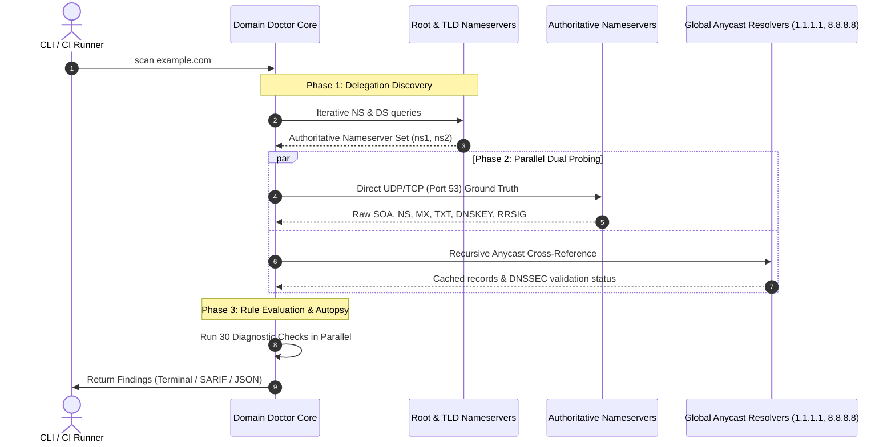
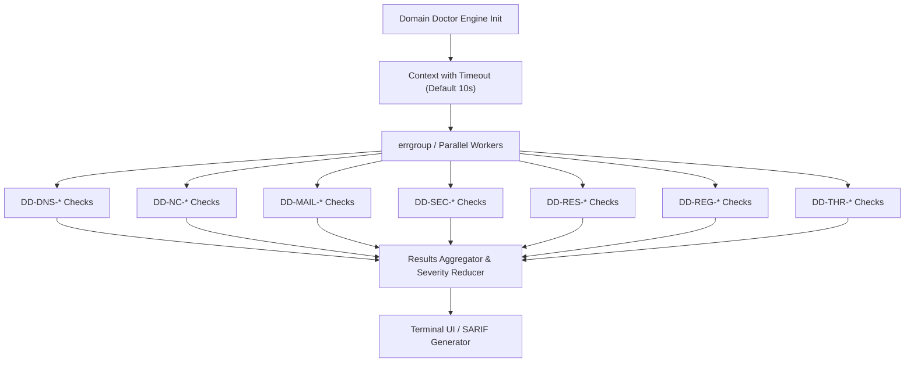

# Architecture & Deep Dive

This document details the internal design, concurrency mechanics, and protocol implementations that power `domain-doctor`.

---

## 🏗️ Core Architectural Philosophy

Traditional DNS diagnostic tools (e.g. `dig`, `nslookup`, web check portals) rely on local stub resolvers or single upstream recursive resolvers. This introduces two major blind spots:
1. **Cached / Stale Answers**: Recursive resolvers cache positive answers for hours and negative answers (`NXDOMAIN`) according to RFC 2308, masking recent misconfigurations or stale delegations.
2. **Anycast Shielding**: You only see the response of the specific Anycast edge node closest to your machine, hiding divergence among authoritative servers in different geographic regions.

Domain Doctor implements an **Authoritative-First Dual-Probing Engine**:



---

## ⚡ Concurrency & Worker Model

All 30 diagnostic audits run concurrently across a centralized context-aware worker pool:



### Key Concurrency Invariants
- **Non-Blocking Fanout**: Slow checks (such as homoglyph permutation probes or TLS handshakes) cannot stall DNS delegation or negative cache calculations.
- **Fail-Fast Cancellation**: If the parent context expires or receives an OS interrupt (`SIGINT`), all background UDP sockets and TLS handshakes are immediately aborted.
- **Memory Efficiency**: Reuses UDP socket buffers and parses DNS wire formats with minimal heap allocations.

---

## 🌐 Public Suffix List (PSL) & Cookie Isolation

To determine domain ownership boundaries and cookie scoping without external network requests, Domain Doctor embeds the Mozilla Public Suffix List (`publicsuffix.org`).

### Trie-Based Suffix Lookup
Domain labels are parsed right-to-left through a trie structure:
- **ICANN Suffixes**: Top-level domains and registry-managed suffixes (e.g. `.com`, `.co.uk`, `.gov.uk`).
- **Private Suffixes**: Multi-tenant cloud platforms (e.g. `github.io`, `s3.amazonaws.com`, `azurewebsites.net`).

### Boundary & Cookie Audits
1. **Public Suffix Check (`DD-REG-001`)**: Ensures the target domain is an actual registrable domain (e.g. `example.com`), preventing scans of raw public suffixes (`co.uk`).
2. **Multi-Tenant Cookie Boundary (`DD-SEC-009`)**: Verifies that apps deployed on shared parent domains (e.g. `my-app.s3.amazonaws.com`) do not set loose `Domain=` attributes that expose cookies to neighboring tenants.
3. **HTTP Cookie Scoping (`DD-SEC-010`)**: Actively inspects `Set-Cookie` response headers against RFC 6265bis specifications.

---

## 🗺️ Zero-API BGP Autonomous System (ASN) Resolution

Most tools query rate-limited, commercial REST APIs (e.g. ipinfo.io, ip-api.com) to resolve nameserver IP addresses to BGP Autonomous Systems.

Domain Doctor uses **Team Cymru IP-to-ASN DNS Queries**, requiring zero third-party API keys or accounts:

### IPv4 Reverse DNS Query
For an authoritative nameserver at `192.0.2.1`:
1. Reverse IPv4 octets: `1.2.0.192`.
2. Append query zone: `1.2.0.192.origin.asn.cymru.com`.
3. Query `TXT` record over standard DNS.
4. Response returns origin ASN, BGP prefix, country code, and registry:
   ```
   "15169 | 192.0.2.0/24 | US | arin | 2000-03-30"
   ```

This architecture enables `DD-RES-001` to detect whether all nameservers are hosted within a single Autonomous System without any external API dependencies.

---

## ⏱️ RFC 2308 Negative Cache TTL Eviction Formula

When an application queries a nonexistent record, recursive resolvers cache the negative response (`NXDOMAIN` or `NODATA`). RFC 2308 defines the exact caching duration:

$$\text{Negative TTL} = \min(\text{SOA.TTL},\; \text{SOA.MINIMUM})$$

Domain Doctor queries the authoritative nameserver to obtain both values, queries public Anycast resolvers in parallel to measure actual TTL decrements, and outputs the exact remaining eviction window in seconds.
