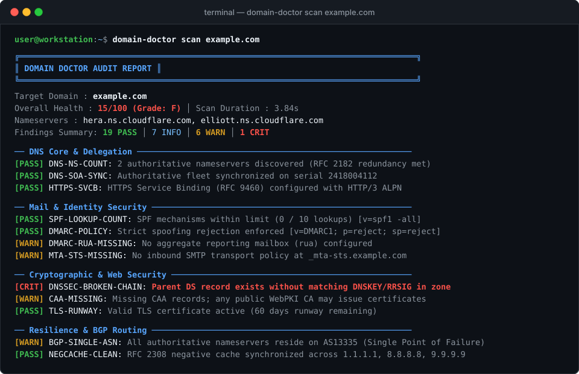
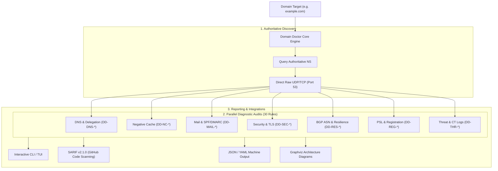
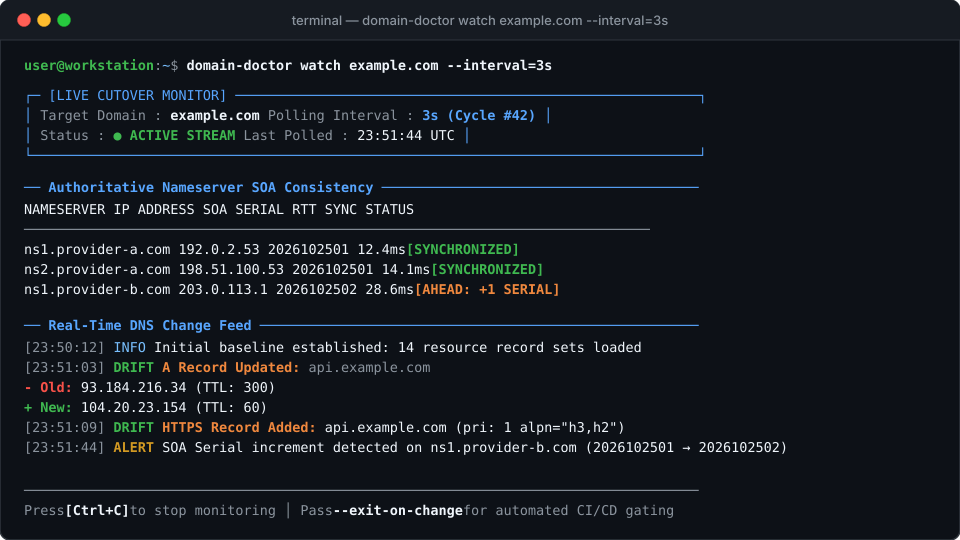
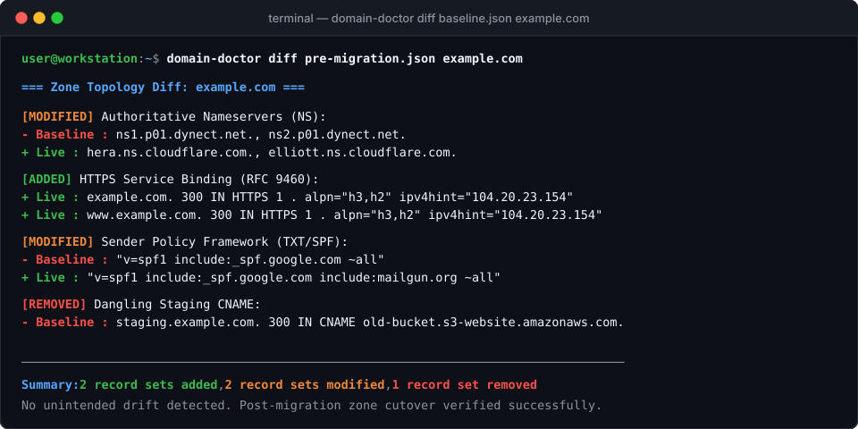

# Domain Doctor

<p align="left">
  <a href="https://github.com/smford/domain-doctor/actions/workflows/ci.yml"></a>
  <a href="https://github.com/smford/domain-doctor/releases"></a>
  <a href="https://scorecard.dev/viewer/?uri=github.com/smford/domain-doctor"></a>
  <a href="LICENSE"></a>
</p>

**Domain Doctor** is a production-grade, authoritative-first domain health inspection, DNS diagnostic analysis, and TLS autopsy CLI & TUI utility written in Go.

It evaluates internet domain reliability, security, and infrastructure resilience. By directly querying authoritative nameservers over raw UDP/TCP and cross-referencing public Anycast recursive resolvers worldwide, it pinpoints delegation errors, mail deliverability misconfigurations, transport security vulnerabilities, RFC 2308 negative cache staleness, BGP routing single points of failure, and infrastructure-as-code drift.

---

## ⚡ Key Highlights

- **Authoritative-First Ground Truth**: Bypasses ISP and proxy caches by directly discovering and querying authoritative nameservers over raw UDP/TCP sockets.
- **30 Security & Diagnostic Audits**: Complete battery of tests covering DNSSEC, DANE, SPF lookup limits (RFC 7208), DMARC policy enforcement, MTA-STS, BIMI, CAA, TLS cipher suites, BGP ASN redundancy, Public Suffix List (PSL) boundaries, and cookie scoping (RFC 6265bis).
- **Unique Rule IDs (`DD-*`)**: Every check maps to a permanent, unique CVE-style identifier (e.g. `DD-MAIL-001`, `DD-SEC-009`) with configurable severities and suppression rules.
- **RFC 2308 Negative Cache Staleness**: Discovers remaining eviction delays ($\min(\text{SOA.TTL}, \text{SOA.MINIMUM})$) across global Anycast resolvers (1.1.1.1, 8.8.8.8, 9.9.9.9) when resolving `NXDOMAIN` records.
- **Static Analysis & Terraform Drift**: Inspects raw BIND zone files without network access (`lint`) and compares live DNS states against `terraform.tfstate` files (`audit-drift`).
- **CI/CD & SARIF v2.1.0**: Native SARIF output for seamless automated scanning in GitHub Actions and direct injection into GitHub Security Code Scanning alerts.
- **Zero Third-Party REST APIs**: BGP ASN lookups query Team Cymru DNS (`origin.asn.cymru.com`) directly; Public Suffix List is embedded; no rate-limited external REST services required.

---

## 📸 Terminal Overview



---

## 🔍 How Domain Doctor Works



---

## 🚀 Quick Usage Workflows

::: tabs
@tab Active Domain Scan
Run a full authoritative security and health scan against any domain:

```bash
# Standard authoritative diagnostic run with colored terminal output
domain-doctor scan example.com

# Filter to specific categories (e.g. mail security and negative caching)
domain-doctor scan example.com --category=mail,negcache

# Generate formatted Markdown report for documentation
domain-doctor scan example.com --format=markdown > audit-report.md
```

@tab Continuous Drift Watch
Monitor a domain in real-time with automatic re-checks and live SOA serial synchronization tracking:



```bash
# Watch example.com every 3 seconds during a migration
domain-doctor watch example.com --interval=3s

# Trigger alerts in CI/CD when DNS records change during cutover
domain-doctor watch example.com --interval=3s --exit-on-change
```

@tab Zone Diffing
Compare live authoritative DNS records against a pre-migration snapshot:



```bash
# Capture pre-migration snapshot
domain-doctor snapshot example.com -o baseline.json

# Diff baseline against live nameservers
domain-doctor diff baseline.json example.com
```

@tab Official GitHub Action
Run automated daily audits and inject security findings directly into GitHub Security:

```yaml
- name: Audit Domain Health
  uses: smford/domain-doctor@v1
  with:
    domain: 'example.com'
    sarif: 'true'
    step-summary: 'true'
```

See [Worked Examples](worked-examples.md) and [CI/CD & SARIF Integration](ci-cd-sarif.md).

@tab Terraform Drift Audit
Detect out-of-band DNS changes made in cloud consoles against your Terraform state:

```bash
# Audit terraform state against live authoritative nameservers
domain-doctor audit-drift example.com --tf-state ./terraform.tfstate
```
:::

---

## 📚 Documentation Navigation

- **[Getting Started](getting-started.md)**: Installation guides (Homebrew, Docker, Static Binaries, Go install), verification with Cosign, and first scan walkthrough.
- **[Worked Examples & Tasks](worked-examples.md)**: Step-by-step guides with authentic CLI outputs for DNS cutovers, mail deliverability debugging, and drift verification.
- **[Rule Catalog](rules.md)**: Complete reference for all 30 diagnostic and security rules (`DD-DNS-001` through `DD-THR-002`), including threat models and remediation steps.
- **[CLI Command Reference](cli-reference.md)**: Exhaustive reference for all 10 CLI subcommands, flags, and usage examples.
- **[Configuration Guide](configuration.md)**: Customizing `.domain-doctor.yaml`, enabling/disabling checks, and setting rule severity overrides.
- **[CI/CD & SARIF](ci-cd-sarif.md)**: Setting up GitHub Actions cron jobs, pull request quality gates, and code scanning alerts.
- **[Architecture & Deep Dive](architecture.md)**: Dual-probing mechanics, BGP ASN Cymru resolution, PSL parsing, and concurrency engine design.
